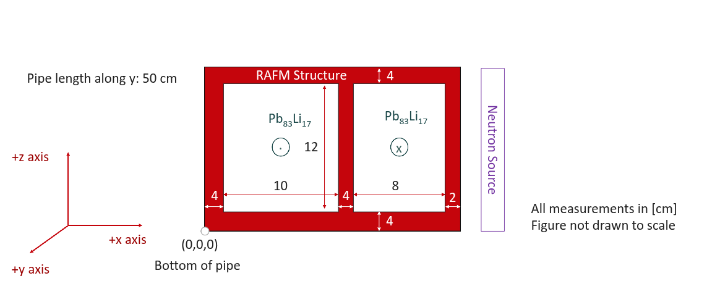

# Two-channel PbLi Multiphysics Model

## Problem Setup

A 50 cm long reduced-activation ferritic–martensitic (RAFM) steel pipe contains two rectangular channels filled with liquid lead–lithium (PbLi). The left channel is 10 cm wide and the right is 8 cm wide. Both are 12 cm high and share a 4 cm steel divider. The intended coolant flow is along +y in the left channel and −y in the right channel.

## Neutron Source description

Neutrons are born uniformly in a 2 × 50 × 20 cm box to the right of the pipe, spanning x = 29–31 cm, y = 0–50 cm, and z = 0–20 cm.  
Each neutron has an energy of 14.1 MeV and travels along −x toward the pipe.
