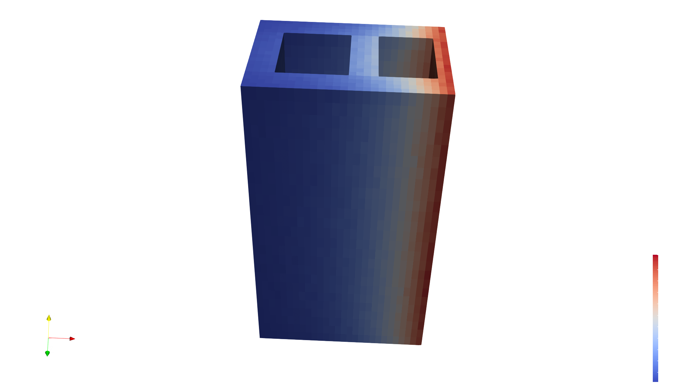
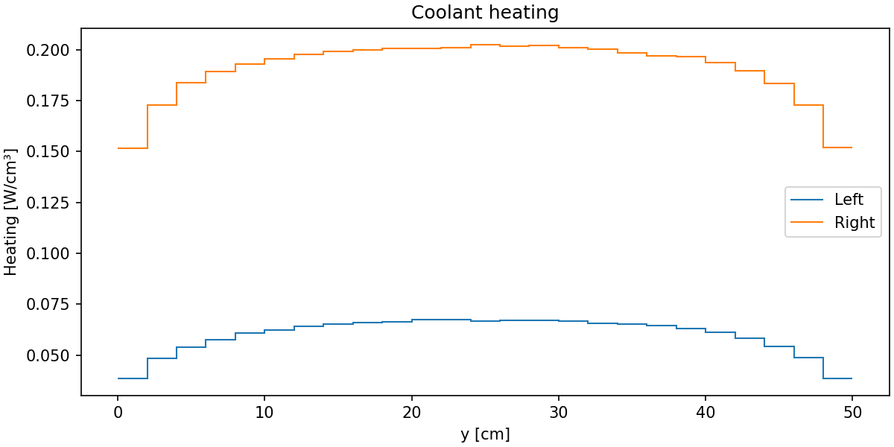
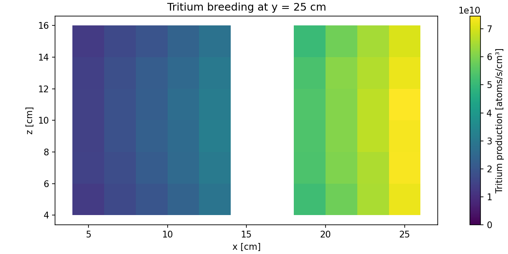

# Cardinal pipe case

Run the steps below from `multiphysics_coupling_example/cardinal/`. Make
`cardinal-opt` available on your PATH (or substitute its full path). Use a
Python environment with the OpenMC package for the XML export, and set
`OPENMC_CROSS_SECTIONS` to the absolute path of your neutron data XML before
running Cardinal.

## 1. Generate the mesh

```bash
python ../mesh_generation/generate_geometry_mesh.py \
  --output ../mesh_generation/generated_pipe_structure_mesh.i
mkdir -p run/meshes
(
  cd run/meshes
  cardinal-opt -i ../../../mesh_generation/generated_pipe_structure_mesh.i \
    --mesh-only pipe_structure_mesh.e
)
```

The Python script reads `../pipe_geometry_info.json` and writes mesh bounds
in meters. Cardinal builds the steel grid, removes the two channel volumes,
and inserts separate coolant grids for heating and tritium. It writes two
Exodus files in `run/meshes/`:

- `tally_domain_in.e` contains the steel heating block, two coarse coolant
  heating blocks (25 axial elements each), and two fine tritium blocks
  (750 left and 600 right). The coarse and fine grids overlap within each
  channel. Each tally in `openmc.i` is restricted to its own block.
- `pipe_structure_mesh.e` contains the steel and coarse coolant blocks.

## 2. Export the transport inputs

```bash
python openmc_model/pipe_model_no_tallies.py
```

The exporter lives in `cardinal/openmc_model/` and writes `geometry.xml`,
`materials.xml`, and `settings.xml` to `cardinal/run/`. The XMLs define the transport geometry,
materials, and neutron source. The tallies are defined in `openmc.i`, and this case runs without
weight windows. If you change physical dimensions, update the OpenMC geometry
as well as the mesh JSON so the transport and tally regions stay aligned.

## 3. Check and run Cardinal

```bash
(
  cd run
  cardinal-opt -i openmc.i --check-input &&
    cardinal-opt -i openmc.i --n-threads=4
)
```

The first command checks setup without running transport. The second runs
OpenMC through Cardinal on the five tally blocks. Edit `particles` and
`batches` in `openmc.i` to change the run size.

The run writes these files alongside the inputs in `cardinal/run/`:

- `openmc_out.e` contains the mesh and per-element fields. Heating is in
  W/m³ and tritium production is in atoms/s/m³. View the final time step.
- `openmc_out.csv` contains block-integrated heating (W) and tritium
  production (atoms/s). The final row gives the completed totals.
- `statepoint.<batch>.h5` contains the raw OpenMC tally statistics.
- `summary.h5` describes the OpenMC model, and `tallies.out` lists the raw
  tally results in text form.

## 4. Postprocess the completed run

From `cardinal/`, with NumPy, netCDF4, and Matplotlib installed:

```bash
python post_processing/postprocess_cardinal.py
```

The script prints the final block totals from `run/openmc_out.csv` and saves
two figures in `plots/`: both axial heating profiles on common axes in
W/cm³, and both x–z tritium slices on a shared color scale in atoms/s/cm³.
For an even number of axial layers, the slice uses the upper of the two
central layers.







The Exodus output carries the mesh generated in Step 1. The script uses
its block names, element connectivity, and coordinates to place values
on the plots, so no grid counts or element ordering are hardcoded. It
uses Cardinal's already normalized fields and converts them from per m³
to per cm³ for display.
