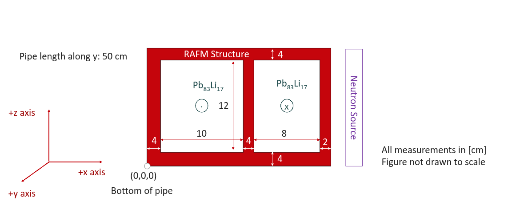
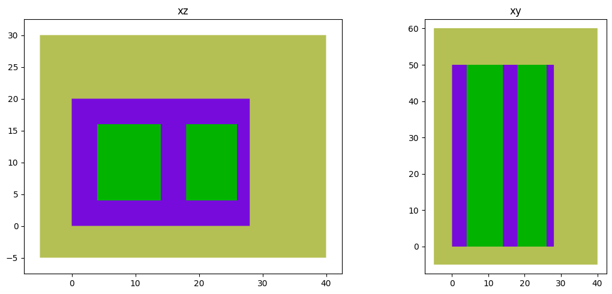
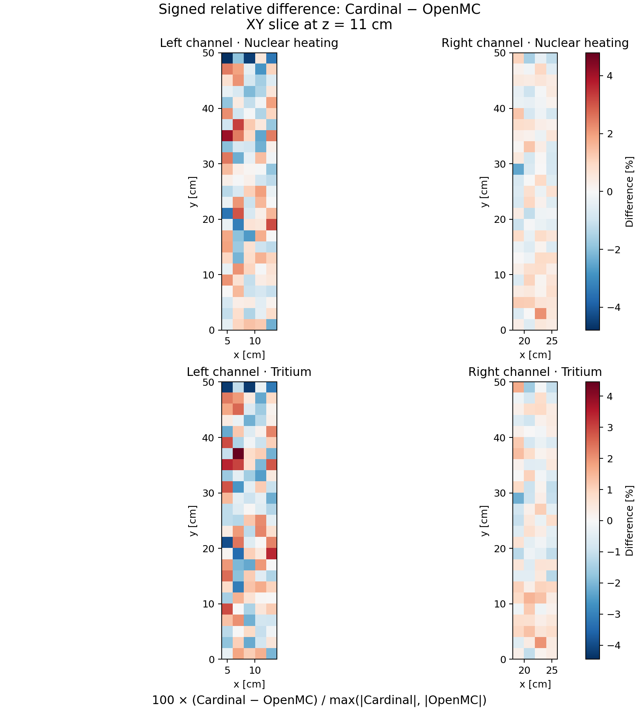

# OpenMC–Cardinal channel benchmark

The cross-section below shows a 50 cm long RAFM steel pipe with two rectangular liquid PbLi channels. The left channel is 10 × 12 cm, the right is 8 × 12 cm, and a 4 cm steel web separates them. The model samples 14.1 MeV neutrons uniformly in a 2 × 50 × 20 cm box to the right of the pipe (x = 29–31 cm) and sends them along −x.



The benchmark compares channel heating (`heating`) and tritium production (`(n,Xt)`) using collision estimators and matching 2 cm bins. The left mesh is 5 × 25 × 6 and the right is 4 × 25 × 6. Both runs use 10 batches of 800,000 source particles, fixed neutron weight windows on the two channels, and a source strength of 4.426602 × 10¹⁶ n/s for normalization. OpenMC geometry uses cm. Cardinal mesh coordinates use m, with a scale factor of 100.



## Saved results

The benchmark model export matches the saved Cardinal geometry, materials, and
settings XMLs, including the source and weight windows. The separate
`openmc_model/model.xml` has the same geometry, materials, source, and tally
definitions, but uses 250,000 particles per batch and has no weight windows.

Reprocessing the saved statepoints and Exodus file confirmed all 750 left and
600 right voxels match geometrically. Cardinal totals were higher than standalone
OpenMC by **0.023% and 0.052%** for left and right heating, and **0.017% and
0.046%** for left and right tritium production. Across the four comparisons,
median voxel differences ranged from **0.62% to 1.27%** and peak differences
from **2.74% to 6.90%**, measured as the absolute difference divided by the
larger magnitude. These figures come from the saved runs.

## Run the benchmark

Use a working OpenMC executable and Python package, a Cardinal build with OpenMC enabled, and Python packages NumPy, h5py, netCDF4, and Matplotlib. Set `OPENMC_CROSS_SECTIONS` to the **absolute path** of your neutron cross-section XML. Use the same data library for both runs. If the executables require different environments, activate the appropriate environment for each step.

From this directory, with `openmc` and `cardinal-opt` on your PATH:

```bash
RUN_OPENMC=1 python inputs/pipe_model.py

mkdir -p run/cardinal
cp inputs/mesh.i inputs/openmc.i run/cardinal/
cp run/openmc/{geometry,materials,settings}.xml run/cardinal/
(
  cd run/cardinal
  cardinal-opt -i mesh.i --mesh-only pipe_mesh.e &&
    cardinal-opt -i openmc.i
)

python scripts/compare_channels.py
python scripts/plot_channel_differences.py
```

Set `OPENMC_EXEC` or substitute the path to your Cardinal executable if needed. The scripts write the per-voxel CSV and a signed difference plot under `run/`. Heating is compared in W/cm³ and tritium production in atoms/s/cm³. The comparison checks the voxel corners before comparing values, so no interpolation is needed. The [saved comparison CSV](results/channel_comparison.csv) and [example difference plot](plots/channel_difference_xy_relative_k3.png) show the original benchmark results.

## Air-filled comparison case

Replace the steel in the pipe region with air while keeping the PbLi channels,
neutron source, tallies, and weight windows the same:

```bash
RUN_OPENMC=1 python inputs/pipe_model.py --structure air
```

The air case writes to `run/openmc_air/`. The steel case writes to `run/openmc/`.

The saved air runs matched all 1,350 coolant voxels. Relative to standalone
OpenMC, Cardinal heating totals differed by **−0.043% (left)** and
**+0.018% (right)**. Tritium production totals differed by **−0.035% (left)**
and **+0.009% (right)**. Median voxel differences were **0.66–1.07%**, with a
maximum of **6.38%**, using the same metric as for the RAFM case.



To run the full OpenMC–Cardinal comparison for the air case, with both
executables available in the active environment:

```bash
bash scripts/run_air_benchmark.sh
```

Set `CARDINAL_EXEC` to select a Cardinal executable and `CARDINAL_THREADS` to set
its thread count. Cardinal writes to `run/cardinal_air/` and the comparison CSV
and plot have an `_air` suffix. To reprocess existing air results, pass
`--structure air` to both Python postprocessing scripts.
